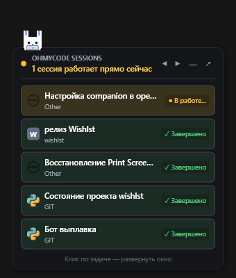

# OhMyCode Status Indicator (с пиксельным тамагочи-компаньоном) 🦙💻

Интерактивный, компактный всегда-поверх-всех виджет сессий для **OhMyCode (OpenCode)** на Windows.

## Возможности

- 🦙 **Пиксельная лама OhMyCode (Тамагочи)**, сидящая прямо на верхнем бортике виджета:
  - 💻 **В работе** — лама открывает металлический ноутбук со светящимся неоновым логотипом и печатает лапками.
  - ⚠️ **Требует ответа** — над головой вспыхивает восклицательный знак, лама подпрыгивает и зовёт пользователя.
  - 💤 **В покое** — ноутбук убран, лама мирно сидит на бортике и моргает глазками.
- 📋 **Список активных и недавних сессий**:
  - Живые статусы: `В работе...` (золотой пульсирующий индикатор) и `Завершено` (изумрудная плашка).
  - Иконки проектов из OhMyCode или цветные буквенные бейджи директорий.
  - Клик по любой карточке сессии сразу разворачивает главное окно OhMyCode.
- 📐 **Эргономика и управление**:
  - Свободное перетаскивание мышью за шапку или прямо за ламу в любое место экрана.
  - Изменение ширины стрелочками `◀` / `▶` или растягиванием за боковые края.
  - Кнопка сворачивания `—` / `+` в ультракомпактную плашку.
  - Автоматическое сохранение позиции и ширины в `indicator-settings.json`.
- ⚡ **Полная автономность**:
  - Написано на C# (WPF, .NET Framework 4.8, встроен в любую Windows 10/11 без сторонних зависимостей).
  - Спрайты встроены прямо в бинарник (не требует внешних картинок).
  - Автоматически считывает порт и пароль сервиса OhMyCode из `%APPDATA%\ru.ohmylama.ohmycode\config\opencode\service-prod.json`.

---

## Быстрая установка (1 клик)

1. Скачайте архив или папку `OhMyCode-Status-Indicator`.
2. Запустите **`install.bat`** от обычного пользователя (права администратора не требуются).
3. Скрипт:
   - Скопирует программу в рабочую папку данных OhMyCode.
   - Зарегистрирует её в автозагрузке Windows (`HKCU\...\Run`).
   - Сразу запустит виджет на экране!

---

## Сборка из исходников (опционально)

Если вы хотите изменить что-то в коде или собрать `.exe` самостоятельно:
- Запустите **`build.bat`**.
- Он использует стандартный системный компилятор `csc.exe` из .NET Framework 4.8 (никаких Visual Studio устанавливать не нужно).

---

## Содержимое репозитория

- `install.bat` — скрипт быстрой установки и запуска.
- `build.bat` — скрипт пересборки `.exe` стандартным компилятором Windows.
- `bin/OhMyCodeStatusIndicator.exe` — готовый скомпилированный бинарник (~32 КБ).
- `bin/OhMyCodeStatusIndicator.cs` — полный исходный код на C# WPF.
- `preview.png` — превью внешнего вида виджета.
